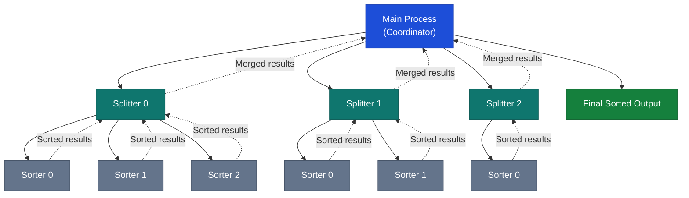

# Operating-Systems-Project-2
# Parallel sorting system in C using process creation and inter-process communication (IPC).


## Overview

This project Implements a Parallel Sorting System in C using process creation and inter-process communication (IPC) to sort the contents of a binary file and distribute the workload evenly. The parent process (coordinator) divides the input dataset into smaller chunks and launches splitter processes, it creates k splitter processes. Each splitter i, creates k-i sorter processes. The sorters can launch sorting processes that independently sort their assigned records using one of two sorting executables (using exec). Pipes transfer the sorted results between processes. The sorters transfer their results to the splitters, the splitters merge those results and transfer them to the coordinator.The parent processes collect those results before merging them into one globally sorted output.
The project demonstrates process creation with fork(), execution of programs, pipes, synchronization with wait(), dynamic memory management, and parallel task decomposition. 

## How It Works

The application follows a multi-process architecture:

1. **Coordinator** – Reads the input dataset, manages the execution, and distributes work to the splitter processes. It creates k splitters.
2. **Splitter** – Each splitter i (from 0 to k-1) divides the assigned data into smaller portions and creates k-i sorter processes. It also gathers the results of the sorters using IPC and merges them too send them back to the coordinator.
3. **Sorter** – Executes the sorting programs (using exec) and handles the sorting of individual data portions and send back their results to the splitters.
4. **Sorting Algorithms** – Sort the records using the implemented sorting routines.
5. **Merging** – Combines the sorted portions into the final sorted output.

Processes communicate using UNIX pipes, while process synchronization is handled using system calls such as `fork()` and `wait()`.

The implementation also handles partial pipe reads and writes to ensure that data is transferred reliably between processes.


## Concurrent Execution

A key feature of this project is the concurrent execution of multiple processes to improve the efficiency of the sorting operation.

Instead of sorting the entire dataset sequentially, the coordinator distributes portions of the input data to multiple splitter processes. Each splitter can then launch multiple sorter processes, allowing different portions of the dataset to be processed concurrently.

Each child process performs its assigned sorting task independently, while the parent processes manage communication and synchronization. UNIX pipes are used to exchange data between processes, and `wait()` is used to ensure that child processes complete their execution before the next stage of processing begins.

This process-based architecture demonstrates:
- **Concurrency:** Multiple sorting processes can execute independently and overlap in execution time.
- **Parallelism:** Sorting tasks can run simultaneously on multiple CPU cores, depending on system resources and scheduling.
- **Synchronization:** Parent processes coordinate child-process completion to ensure that all sorted portions are available before merging.
- **Inter-process communication:** Pipes allow processes to exchange input data and sorted results.

By dividing the workload across multiple processes, the project demonstrates how concurrent execution can be used to tackle computational tasks in an operating-system environment.

## Technologies and Concepts

- C programming language
- UNIX/Linux system calls
- Process creation with `fork()`
- Inter-process communication (IPC) using pipes
- Process synchronization with `wait()`
- Parallel processing
- Sorting and merging algorithms
- Binary file handling

## Input Data

The project includes binary datasets of different sizes for testing:

- `voters50.bin`
- `voters500.bin`
- `voters5000.bin`

These files contain records that are processed and sorted by the application.

## Compilation and Execution

Compile the project using GCC:

```bash
make all
```

And delete the executable files using: 

```bash
make clean
```

Run the program accordingly:

```bash
/final -i <filepath of the test file> -k <integer> -e1 <filepath of the sorting executable 1> -e2 <filepath of the sorting executable 2>
```

e.g.

```bash
/final -i voters5000.bin -k 4 -e1 ./sorting1 -e2 ./sorting2
```


## Learning Objectives

This project explores practical operating-system concepts, particularly:

- Managing multiple processes.
- Distributing computational work.
- Implementing inter-process communication.
- Synchronizing concurrent processes.
- Handling data transfer through pipes.
- Understanding the challenges of parallel execution.


